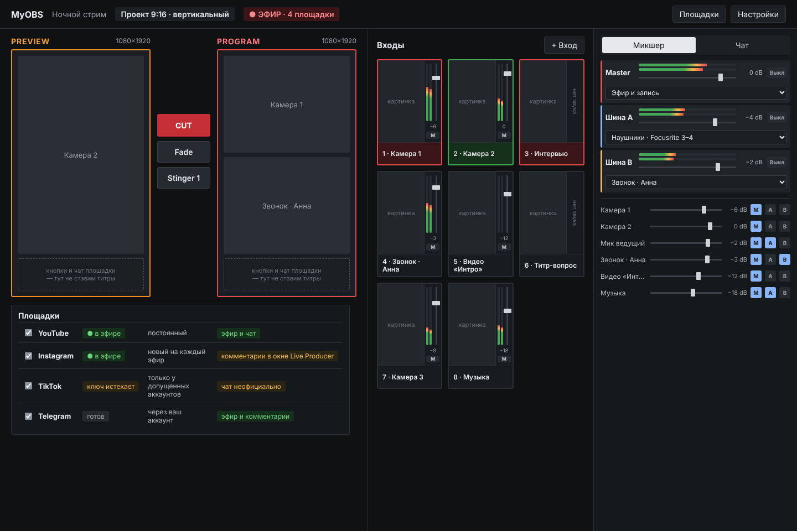
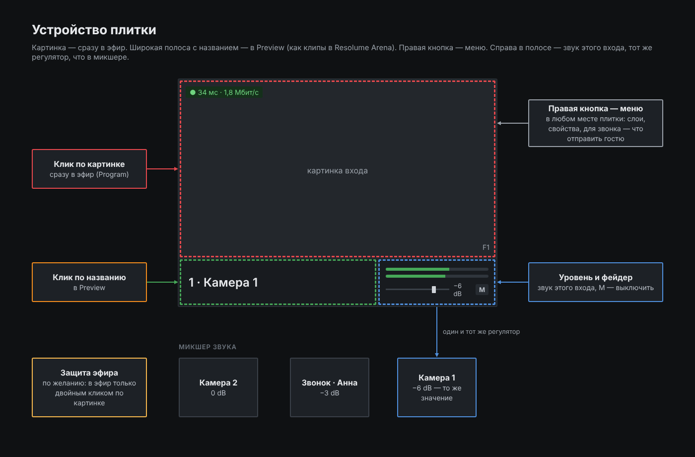
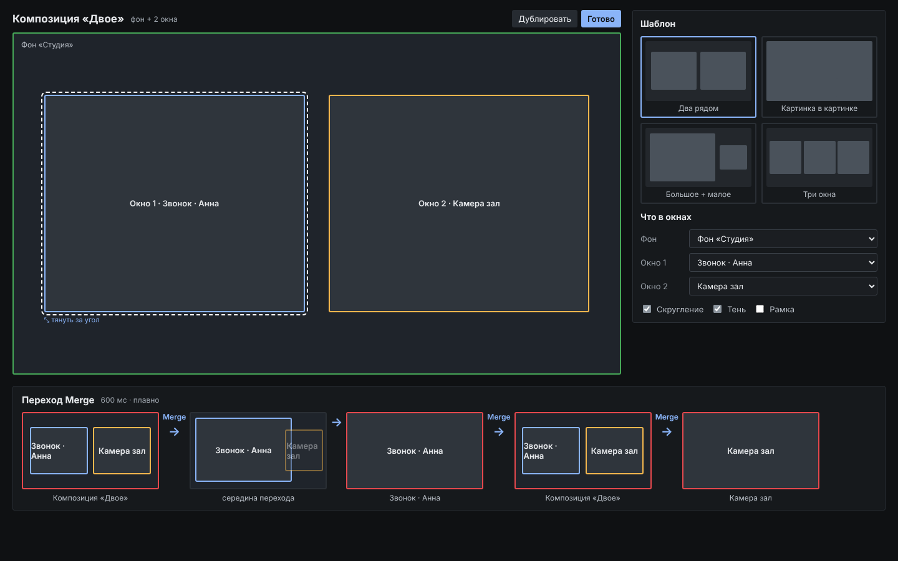
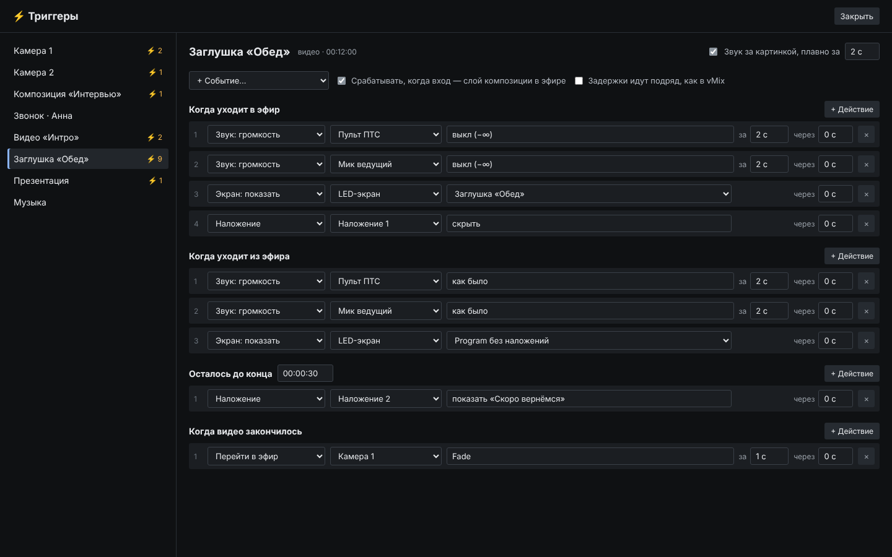
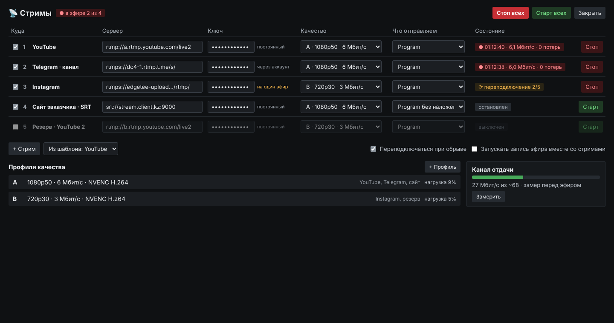
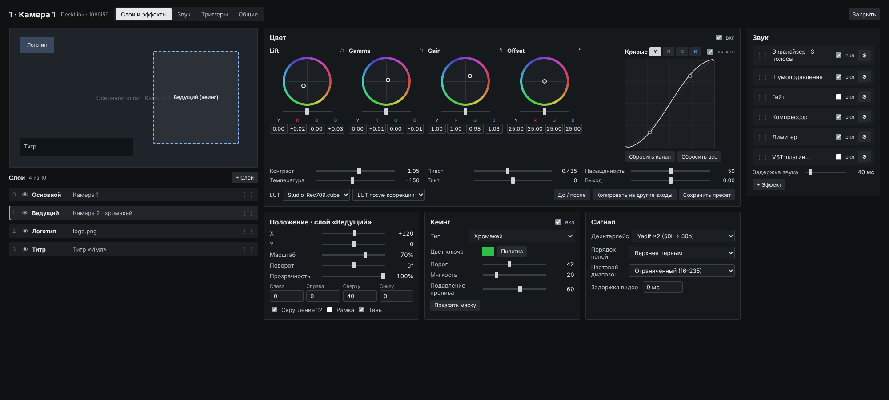

# MyOBS

**Программа для прямых эфиров под Windows: переключение как в vMix, надёжность как у эфирного железа.**
Открытый проект. Построен на движке OBS (libobs) как на библиотеке. Интерфейс, переключатель,
воспроизведение клипов, звук и триггеры — свои.

> Статус: **идёт разработка** (этап 1 из 5). Картинки ниже — **концепт интерфейса**, а не
> снимки готовой программы. Готовые сборки появятся во вкладке Actions / Releases.



## Зачем ещё одна программа

OBS хорош для одного стримера, но в живом эфире с несколькими камерами, клипами, звонками и
LED-экранами ему мешают собственные решения. Мы их измерили автотестом: на каждом переключении
на обычный видеоклип OBS выдаёт в эфир пустой кадр — тот самый «микроплан». MyOBS устроен
иначе:

- **Эфир — это святое.** Всё, что не эфир (миниатюры, мультивью, экраны), уступает ему кадр.
- **Клипы как в монтажке.** Каждый такт эфира вход отдаёт кадр *по номеру* из заранее
  декодированного запаса. Пустой или чужой кадр невозможен по конструкции. Пауза = номер
  перестаёт расти, поэтому клип продолжает ровно с того кадра, на котором ушёл из эфира.
- **Переключение по такту.** CUT, наплыв и Merge срабатывают на границе кадра. Клик во время
  перехода не теряется.
- **Рабочий кодек — стандартный H.264** (ключевой кадр каждые 10 кадров, без B-кадров):
  мгновенный переход к любому кадру, декодирование на видеоблоке NVIDIA, без сторонних кодеков.
- **Звук на том же счёте кадров**, что и картинка: после пауз и перемоток не разъезжается.
- **Только дискретная видеокарта** для рендера, даже если главный монитор подключён к встроенной.

## Что будет в программе

| Область | Возможности |
|---|---|
| Переключатель | Preview / Program, CUT, Fade, Merge (картинка-в-картинке ↔ полный экран), стингеры, очередь кликов |
| Входы | Клип (рабочий кодек), камера, DeckLink, NDI, картинка, браузер, звонок (WebRTC), композиция; каждый вход — сцена со слоями |
| Плитки | Клик по картинке — в эфир, по названию — в Preview; живая миниатюра, уровень и фейдер звука, кнопки наложений 1–4, ● REC |
| Вкладки | Камеры, Медиа, Звонки, Композиции — свой цвет и размер плиток |
| Звук | Шины Master / A / B (устройство или звонок), PFL, «звук следует за видео», шумодав, гейт, эхоподавление на звонках |
| Наложения | 4 канала с плавным появлением |
| Экраны | Любой источник на любой монитор или LED (как Fullscreen в vMix), масштаб, управление триггерами |
| Триггеры | События входа (ушёл в эфир, ушёл из эфира, осталось N секунд, видео закончилось) → действия со звуком, экранами, наложениями |
| Площадки | Мультистрим: YouTube и Telegram через API, Instagram и TikTok по ключу; общий чат, вывод сообщений в наложение |
| Запись | Рекордер эфира и входов, файл не теряется при сбое |
| Формат | Один на проект: 16:9 или 9:16 |
| Цвет и ключ | Lift / Gamma / Gain / Offset с RGB+Y, кривые, LUT, кеинг, деинтерлейс, звуковые эффекты на входе |
| Управление | Горячие клавиши и OSC для всех функций через единую шину команд |
| Нагрузка | Монитор нагрузки и аналитика входов (опоздания, потери, буфер) |
| MyOBS Encoder | Отдельная программа: перекодирует материалы в рабочий кодек в фоне, не мешая эфиру |

### Концепт интерфейса

| | |
|---|---|
|  |  |
| Плитка входа | Композиции и переход Merge |
|  |  |
| Триггеры | Мультистрим |



## План

1. **Каркас** — движок на дискретной видеокарте, свои Program/Preview, автосборка и автотесты. *(идёт)*
2. **Переключатель и входы** — CUT / Fade / Merge по такту, Клип, камера, картинка, звонок, интерфейс плиток.
3. **Звук** — шины, PFL, фейдеры на плитках, автотест синхрона.
4. **Выходы** — мультистрим, рекордер, экраны и LED, наложения.
5. **Триггеры, OSC, аналитика, MyOBS Encoder, установщик.**

Каждый этап закрывается автотестами: в каждый кадр тестового сигнала зашит его номер, и программа
проверяет каждый кадр эфирного выхода — вспышки, порядок, паузы.

## Сборка

Собирается автоматически на GitHub (вкладка **Actions**): движок OBS собирается один раз и кэшируется,
затем программа и автотесты. Готовая папка программы — артефакт `myobs-windows` у сборки.

Локально на Windows (Visual Studio 2026, CMake 3.28+):

```
pwsh ci/build-engine.ps1
pwsh ci/build-app.ps1
pwsh ci/run-tests.ps1
```

## English

**MyOBS** is an open-source Windows live production switcher in the spirit of vMix, built on the OBS
engine (libobs) as a library, with its own interface, frame-accurate switching, an editing-style clip
player (frame pulled by number on every tick — no blank or stale frames on take), a standard H.264
working codec, audio buses, triggers and multistreaming. Work in progress; images above are interface
concepts.

## Лицензия

GPL-2.0-or-later. Движок — [OBS Studio](https://github.com/obsproject/obs-studio) (libobs),
спасибо его авторам. Проект не связан с OBS Project и не одобрен им.
